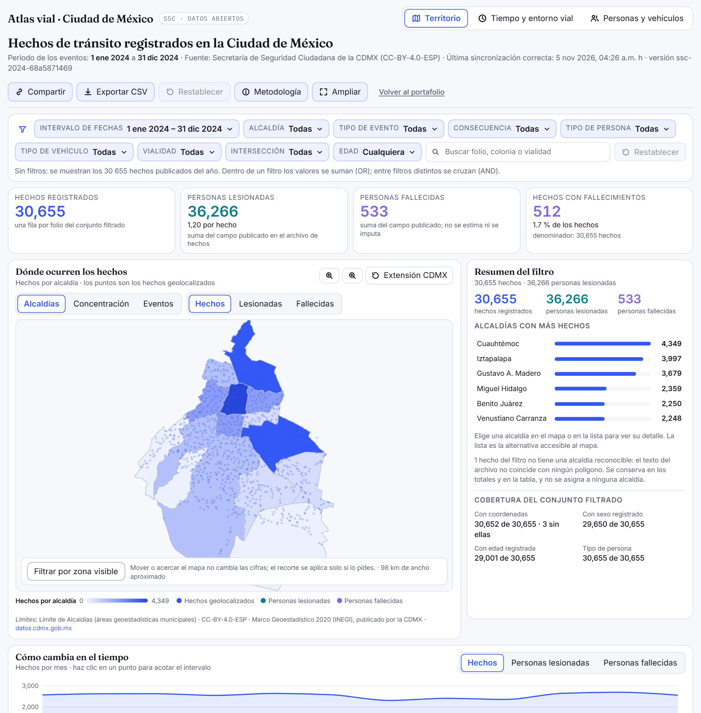

# Atlas vial · Ciudad de México

Mapa, series y desgloses de los **hechos de tránsito de 2024** registrados por la
Secretaría de Seguridad Ciudadana de la Ciudad de México, con datos abiertos,
filtros conectados y la cobertura de cada desglose siempre a la vista.

[](https://github.com/Dev-HugoAguilar/cdmx-traffic-atlas/actions/workflows/tests.yml)
[](app)
[](#datos-y-atribución)

> **Alcance.** Aplicación de visualización; no sustituye los datos abiertos de la
> SSC. Los archivos de personas y vehículos traen **un registro por folio** —la
> persona y el vehículo principales del expediente—, no todas las víctimas ni
> todos los vehículos.

---

## Ejecutar

La aplicación consume la API del portafolio (`portfolio-api`), que debe estar
escuchando en el puerto 8010:

```bash
# terminal 1: API
python -m uvicorn app.main:app --port 8010

# terminal 2: aplicación
cd app
npm ci
npm run dev
```

Compilación de producción: `npm run build` (escribe en `app/dist/`, dentro del
repositorio, y minifica el bundle).



## Qué demuestra

- **Un mapa que declara su cobertura**: hechos georreferenciados con el límite de
  alcaldías como referencia territorial, no como atribución del hecho.
- **Desgloses que no se suman entre sí**: sexo, edad y tipo de persona se
  presentan por separado, con su cobertura explícita, porque unirlos por folio
  inventaría combinaciones.
- **Datos faltantes visibles**: los hechos sin edad o sin sexo se muestran como
  «Sin dato», nunca como cero.
- **Filtros conectados**: mapa, series y tabla responden al mismo estado.

## Estructura

```text
app/                 Aplicación React + TypeScript (Vite)
  src/               Componentes, estado, consultas y visualizaciones D3
  tools/             Verificadores de navegador y minificador del bundle
  index.html         Entrada de la aplicación
  vite.config.ts     Build hacia app/dist (sin escribir fuera del repositorio)
docs/LEEME.md        Documentación original del proyecto
docs/cover.jpg       Captura real de la aplicación
```

## Datos y atribución

**SSC CDMX**, conjunto «Hechos de tránsito registrados por la SSC 2024 (serie de
datos ampliada, no comparativa)», catálogo de datos abiertos de la CDMX, licencia
**CC-BY-4.0-ESP**. Cobertura: 1 de enero a 31 de diciembre de 2024, cinco recursos
(hechos; personas por sexo, por edad y por tipo de persona; vehículos). Límites de
alcaldías: «Límite de Alcaldías», CC-BY-4.0-ESP, a partir del Marco Geoestadístico
2020 del INEGI.

## Límites

- Un registro por folio: no son todas las víctimas ni todos los vehículos del
  expediente; se presentan como «hechos con registro de…».
- Los desgloses de sexo, edad y tipo de persona no se suman ni se cruzan entre sí.
- 1 654 hechos no tienen edad registrada y 1 005 no tienen sexo: aparecen como
  «Sin dato».
- La entidad o alcaldía del registro no es necesariamente el lugar del hecho.

## Seguridad y contribución

Sin credenciales ni datos personales en el repositorio. Ver [`SECURITY.md`](SECURITY.md)
y [`CONTRIBUTING.md`](CONTRIBUTING.md).
